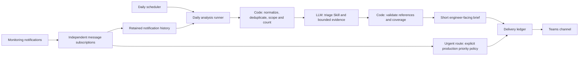

# Alert Management Agent

Engineering lessons from building an AI-assisted alert triage MVP: turn overlooked alerts into a short list of issues engineers can actually investigate.

**By [Jay Tian](https://github.com/Tian99).** This repository contains an anonymized case study, architecture, a reusable triage Skill, and fictional examples. It is a documentation repository, not a deployable agent distribution or an export of an employer's code.

## The problem I wanted to solve

The main problem was not a shortage of monitoring. It was a shortage of attention.

Critical alerts already had a response path. Lower-priority alerts often went unread. Some were repetitive threshold crossings; others contained useful signals about recurring failures, capacity pressure or incomplete processing. Treating all of them as noise could hide problems worth fixing.

I wanted a daily brief that answered three questions:

1. What deserves follow-up, and why?
2. What can be observed for now, and what would change that decision?
3. Where can an engineer find the original evidence?

A list of open and closed incidents was not enough. **Closed does not mean harmless, and open does not necessarily mean ongoing business impact.**

## The design

The urgent route does not wait for the daily model analysis. The LLM does not choose recipients, manufacture incident links, acknowledge alerts or close incidents.

The implementation experience used Google Cloud messaging, BigQuery, Cloud Run, an ADK-based interactive agent, Gemini, Terraform, GitHub Actions and Teams Workflows. These are technology choices, not requirements for adopting the design.

[Read the architecture and runtime boundaries](docs/architecture.md).

## What code should do, and what the LLM should do

**Code owns facts and side effects:** identity normalization, notification deduplication, incident lifecycle grouping, time windows, environment scope, counts, reference checks, delivery destinations and retry limits.

**The LLM owns provisional interpretation:** explain recurring patterns, distinguish a useful investigation from a low-urgency observation, identify missing evidence, and suggest the next check.

The model returns evidence-linked findings. Code checks that every supplied incident appears exactly once, that references exist, and that groups do not mix environments. A schema improves structure; it does not establish that the interpretation is correct. Google's [structured-output documentation](https://docs.cloud.google.com/gemini-enterprise-agent-platform/models/capabilities/control-generated-output) describes the API mechanism; the semantic checks remain application work.

## The triage policy

- **Follow up:** supplied evidence supports a concrete investigation or planned corrective action.
- **Needs verification:** a missing fact could change the action. Name that fact and the cheapest useful check.
- **Observe:** evidence supports lower urgency for now. State when to reassess; do not call it a confirmed false positive.

Severity is an input, not the complete decision. Environment, recurrence, metric meaning and available outcome evidence matter too. Operators may define explicit scope exclusions, but an exclusion is not a diagnosis.

[Read the triage playbook](docs/triage-playbook.md) or inspect the [portable Skill](skills/alert-triage/SKILL.md). The Skill is newly written generic guidance, not the private implementation's original policy file.

## A brief an engineer can use

**Fictional example; names, counts, measurements and links are invented.**

> **Alert Management Agent | Daily Summary — Sample**
>
> 🟠 **2 issues to follow up** · 🔵 **1 needs verification** · ⚪ **1 group to observe**
>
> Recurring worker failures and database capacity pressure deserve follow-up. A failed task attempt needs its final outcome checked.
>
> 🟠 **PROD · Reporting database — Disk above threshold** 
> Repeated threshold crossings suggest a capacity review is worthwhile. 
> **Next:** Check growth and remaining space before choosing cleanup or expansion. 
> 📍 `demo-production / reporting-db` · [Open sample incident](https://example.com/incidents/demo-disk-01)
>
> ⚪ **Observe** 
> A recovered test-environment CPU alert has no demonstrated impact in the supplied evidence. Reassess if it recurs or affects execution time.
>
> Assessment uses received alerts and history. Recovery does not confirm successful processing.

[See the complete sample brief](examples/daily-brief.md) and its [synthetic findings](examples/findings.json).

## The lessons that mattered most

1. **Start with the ignored alerts.** A useful agent can surface neglected work without replacing the urgent response path.
2. **Count incidents, not messages.** Trigger, recovery, redelivery and multi-team routing are different concepts.
3. **Preserve trigger evidence.** A recovery value should not erase the measurement that caused the alert.
4. **Read metric semantics.** An aggregation window is not an outage duration; a failed attempt is not a failed job.
5. **Make uncertainty useful.** “Check the final retry result” is more useful than an unsupported root-cause claim.
6. **Design the brief for action.** A short reason, next check and original link beat a wall of status text.
7. **Separate workflow success from AI success.** A job can exit successfully while its model analysis has failed.
8. **Verify the actual deployed image.** Merging application code does not automatically update every scheduled runtime.

[Read the detailed lessons and failure modes](docs/lessons-learned.md).

## What this experience does and does not establish

Normalization, routing and validation logic were exercised with offline checks. Native Skill loading and a Teams connection were also exercised. Those checks do not establish model judgment quality or prove an urgent notification's complete production path.

The daily model path encountered an analysis failure that was still awaiting runtime diagnosis when this account was written. Diagnostic and structured-output changes should not be described as a confirmed fix before the real runtime is rerun.

There is no measured precision, recall or production-wide success rate to report here. Selective live-log investigation, reusable investigation memory and automatic ITSM ticket handling are extension designs, not completed capabilities in this case study.

[Validation and rollout checklist](docs/validation-and-rollout.md).

## References

- [Google SRE: Monitoring Distributed Systems](https://sre.google/sre-book/monitoring-distributed-systems/) — useful foundations for actionable, symptom-oriented monitoring.
- [Google SRE Workbook: Alerting on SLOs](https://sre.google/workbook/alerting-on-slos/) — useful when customer-facing SLI/SLO evidence is available; this MVP did not implement a burn-rate engine.
- [ADK Skills](https://adk.dev/skills/) — packaging and loading reusable agent instructions.
- [Microsoft Teams Workflows webhooks](https://support.microsoft.com/en-us/workflows/send-messages-in-teams-using-incoming-webhooks) — sending an external application's card to a chosen chat or channel.

All included examples are synthetic. No company names, private repositories, cloud resource identifiers, incident exports, credentials, screenshots or internal links are included.
