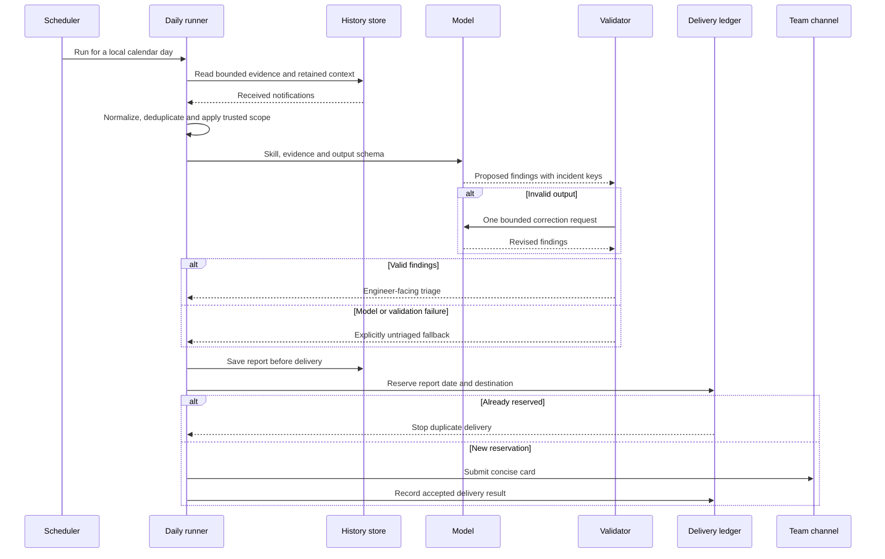

# Architecture and runtime boundaries

The useful separation is between collecting evidence, interpreting it and taking an external action. A model call should not own all three.

## Collection and retained history

Attach independent subscriptions to the existing alert message streams. This gives the analysis pipeline its own delivery and retention behavior without consuming messages from an existing team's subscriber.

Store the original received notifications and their publication times. Build normalized incident evidence from that history, keeping the source mapping explicit. Retained history starts when collection starts; it is not a backfill of earlier chat messages.

The history layer supports distinct-incident recurrence, recovery evidence and daily queries. It does not automatically reveal the current health of a service.

## Daily path

A destination accepting the webhook request is not the same evidence as a person seeing the card. A timeout after reservation is an uncertain delivery, not permission to retry indefinitely. Keep an investigation path for uncertain sends and an explicit procedure for corrected reports.

## Urgent path

An explicit urgent-priority policy can route eligible production notifications without waiting for a model. Apply trusted environment scope, freshness checks, incident identity and a separate delivery ledger before sending.

An operator-approved nonproduction exclusion can stop notifications while preserving raw history. It should not silently relabel an excluded incident as a false positive. An urgent notification is also not automatically a new ITSM ticket; repeated notifications can belong to an existing incident.

## Interactive agent versus scheduled analysis

The interactive agent can have explicitly configured read-only repository tools. The scheduled model call in this MVP was evidence-only; including the same Python package in an image did not give that model call a tool loop.

A shared read-only GitHub library lets agents reuse transport and parsing logic while keeping separate repository allowlists. It is a shared library, not necessarily an MCP server. An allowlist limits what the application requests; it does not grant repository access or satisfy SSO authorization.

Likewise, a Skill provides decision guidance. It does not grant a logging role, introduce an API integration or create persistent memory. ADK's [Skills documentation](https://adk.dev/skills/) explains the loading mechanism; verify packaged files and the returned instructions in the actual runtime.

## Extension boundary

Selective log queries, execution-result checks, metric lookups, reusable findings and ITSM ticket updates are future integrations in this account. Add each as a bounded capability with explicit access and evidence provenance. Do not draw a planned tool as an already deployed capability.
